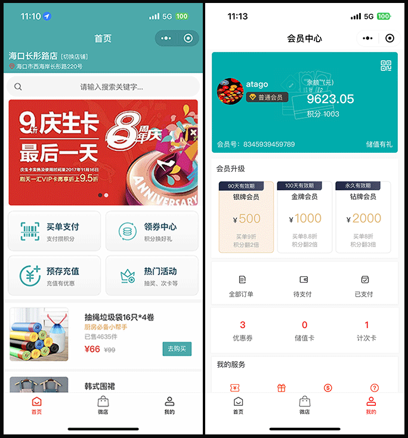
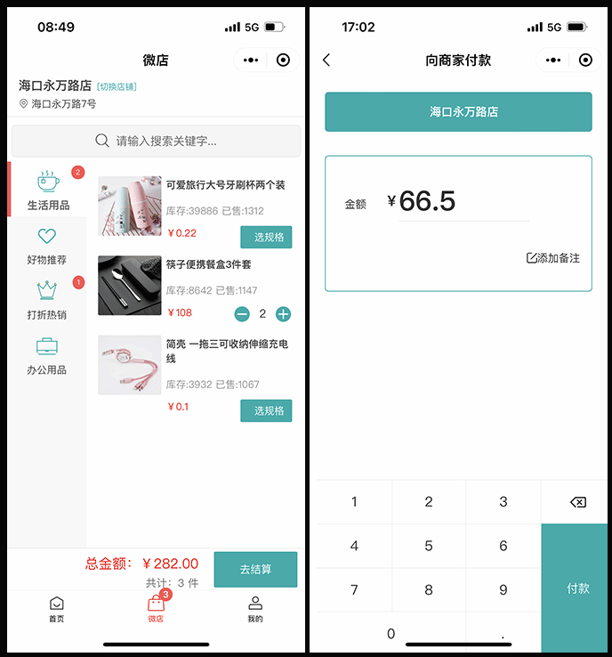
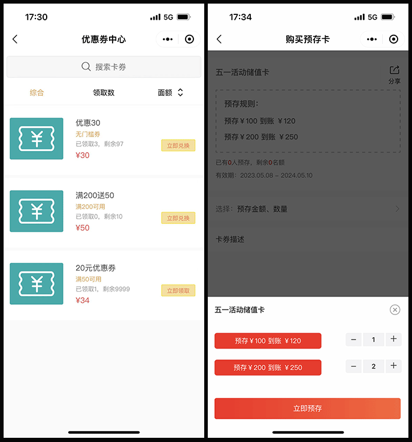
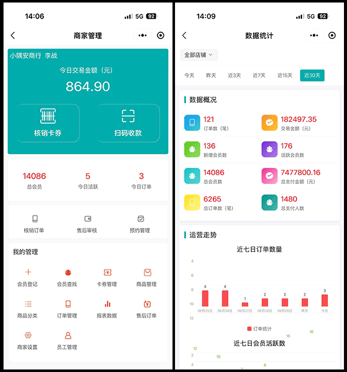
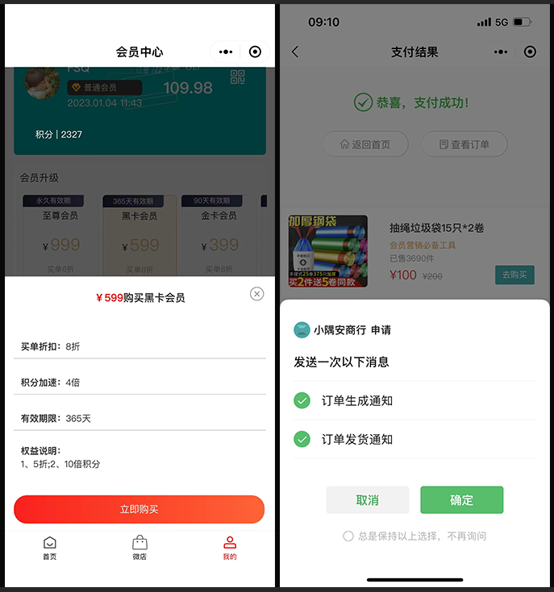
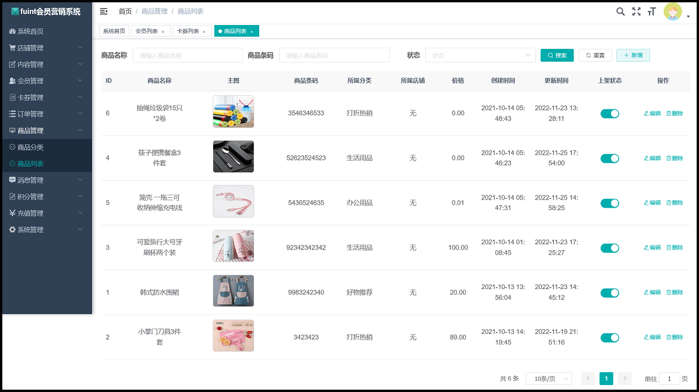
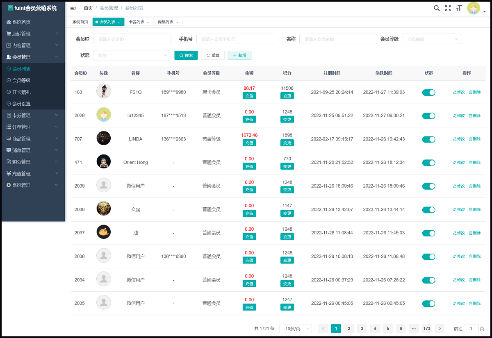
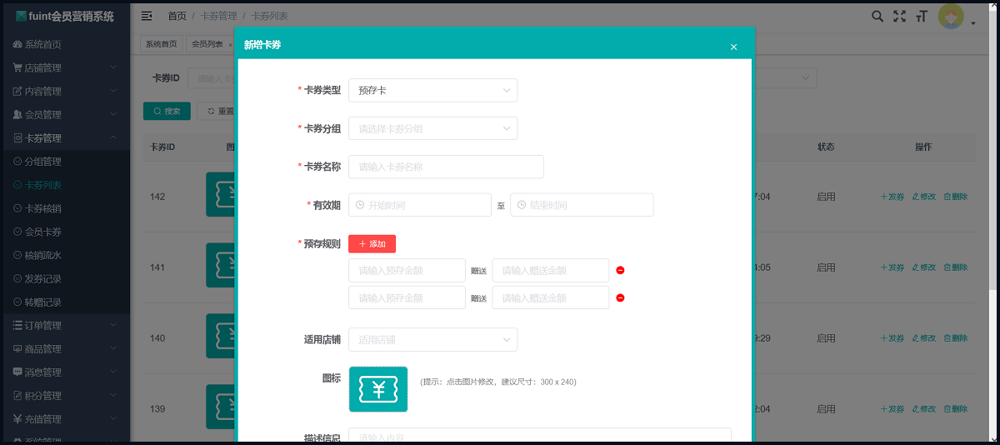
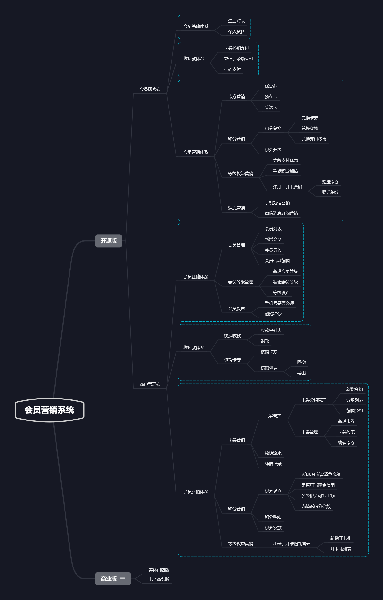

# fuint会员营销系统介绍

#### 介绍
fuint会员营销系统是延禾技术（www.fuint.cn）完全自研的一套开源的实体店铺会员管理和营销系统。系统基于前后端分离的架构，后端采用Java SpringBoot3 + Mysql，前端基于当前流行的Uniapp，Vue3、Element UI Plus，支持小程序、h5。主要功能包含电子优惠券、储值卡、实体卡、集次卡（计次卡）、短信发送、储值卡、会员积分、会员等级权益体系，支付收款等会员日常营销工具。本系统适用于各类实体店铺，如生鲜、零售超市、酒吧、酒店、汽车4S店、鲜花店、奶茶店、甜品店、餐饮店、农家乐等，是实体店铺会员营销必备的一款利器。
以下是会员端前台的页面展示：

fuint侧重于线下实体店的私域流量的运营，同时提供会员端小程序和收银系统的线上线下统一渠道，帮助商户降低获客成本。顾客通过扫码支付成为私域流量，支付即可成为会员。积分和卡券功能建立起会员等级体系，通过消息推送和短信营销方便触达用户。
1、会员运营自动化：商家通过日常活动设置，如开卡礼设置，沉睡唤醒等，成为会员后自动给顾客送优惠券，让顾客更有黏性，提升会员运营效率。
2、打通收银系统和会员营销的壁垒，代客下单收银，支付即成为会员。
3、会员体系完整化：积分兑换、积分转赠、会员等级权益、积分加速、买单折扣。
4、会员卡券齐全：储值卡、电子券、优惠券、集次卡、计次卡、实体卡购买并兑换、会员充值、余额支付。
5、线上代客下单收银系统，后台管理员可帮助临柜的会员下单、扫码支付。
6、支持手机短信、站内弹框消息、微信订阅消息：支持包括发货消息、卡券到期提醒、活动提醒、会员到期提醒、积分余额变动提醒等消息。
7、具有门店预约、到店支付等线上线下结合的o2o能力。
小程序前端仓库：https://gitee.com/fuint/fuintStoreSystemFront

扫码小程序演示：

官网演示地址：
1、官网：https://www.fuint.cn 点击 -> 系统演示，演示账号：fuint / 123456
2、swagger接口文档：https://www.fuint.cn/fuint-application/swagger-ui.html

#### 软件架构
后端：JAVA SpringBoot3 + MYSQL Mybatis Plus + Redis
前端：采用基于Vue3的Uniapp、Element UI Plus，前后端分离，支持微信小程序、h5等

后台截图：

#### 前端使用技术：
2.1 Vue3 Vite；
2.2 Uniapp；
2.3 Element UI Plus；
2.4 Nodejs；
2.5 Electron Js；

#### 后端使用技术：
1.1 SpringBoot3.2；
1.2 Mybatis Plus；
1.3 Maven；
1.4 SpringSecurity；
1.5 Druid；
1.6 Slf4j；
1.7 Fastjson；
1.8 JWT；
1.9 Redis；
1.10 Quartz；
1.11 Mysql 5.7或8版；
1.12 Swagger UI；

#### 安装步骤
软件环境版本：jdk17+、mysql 5.7或5.8、Redis6+ 任意版本
1. 导入db目录下的fuint-db.sql数据库文件。
2. 修改configure目录下的配置文件。
3. 将工程导入Idea，并安装插件：Lombok Plugin。
3. 使用maven执行install，打jar包（在fuint-application/target目录），把jar包上传并执行启动：
   nohup java -Dfile.encoding=UTF-8 -Xmx2048m -Xms2048m -Xss256k -Xmn1024m -jar fuint-application-1.0.0.jar
提示：无后端和linux基础的朋友，可以使用<b>宝塔</b>部署，非常方便简单。

#### 前台使用说明
1.  会员登录，登录成功后可看到会员的卡券列表。
2.  卡券领取和购买，预存券的充值等。
3.  核销卡券，会员在前台出示二维码，管理员用微信扫一扫即可核销。
4.  卡券转赠，会员可将自己的卡券转赠给其他用户，输入对方的手机号即可完成转赠，获赠的好友会收到卡券赠送的短信。

#### 后台使用
1. 会员管理：会员等级、会员新增、导入、禁用等。
2. 内容管理：焦点图管理、文章管理等。
3. 卡券管理：电子券管理为2层结构，即电子券组和电子券。
4. 会员积分：会员积分管理，会员积分的操作，会员积分明细查看。
5. 转赠管理：卡券转赠记录。
6. 短信管理：短信营销功能，已发送的短信列表。
7. 系统配置：配置系统管理员权限等。
8. 店铺管理：支持多店铺模式。
9. 核销管理员:核销人员管理主要包含3个功能：核销人员列表、核销人员审核、核销人员信息编辑。
10. 短信模板管理：可配置不同场景和业务的短信内容。
11. 卡券发放：单独发放、批量发放，发放成功后给会员发送短信通知
12. 操作日志主要针对电子券系统后台的一些关键操作进行日志记录，方便排查相关操作人的行为等问题。
13. 发券记录主要根据发券的实际操作情况来记录，分为单用户发券和批量发券，同时可针对该次发券记录进行作废操作。
14. 代客下单、收银功能，支持小票打印，包括本地打印和云打印（对接芯烨云打印服务）。
卡券营销：

收银代客下单功能：店员角色登录后台，从首页的“下单首页”菜单可进入代客收银下单界面，完成代客下单收银的流程。

收银发起结算：

系统导图：

#### 开发计划
1. 更完善的报表统计；
2. 分享助力、分享领券、分享获得积分；
3. 员工提成、分销功能；
4. 更多营销工具，比如签到等。

#### 允许使用范围：
1.  允许个人学习使用
2.  允许用于毕业设计、论文参考代码
3.  推荐Watch、Star项目，获取项目第一时间更新，同时也是对项目最好的支持
4.  希望大家多多支持原创软件
5.  请勿去除版权标签，要商用请购买源码授权（非常便宜），感谢理解！

不足和待完善之处请谅解！源码仅供学习交流，更多功能欢迎进群咨询讨论，或需安装帮助请联系我们（麻烦先点star！Thanks♪(･ω･)ﾉ）。
官方网站：https://www.fuint.cn 
开源不易，感谢支持！
作者wx：fsq_better

#### 特别鸣谢：
1. Mybaits Plus: https://github.com/baomidou/mybatis-plus；
2. Vue: https://github.com/vuejs/vue；
3. Element UI: https://element.eleme.cn；
